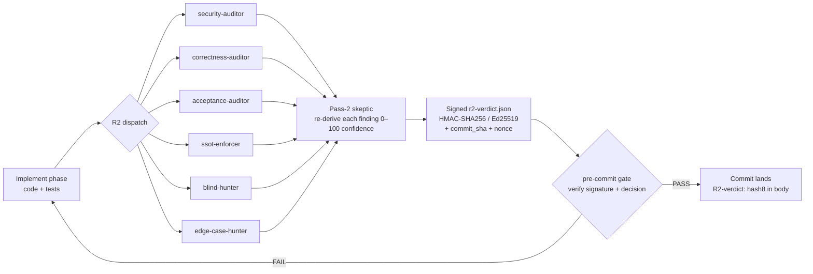

# cortex-x

> **Persistent memory across all your projects + an overnight maintenance agent that opens draft PRs while you sleep.** A [Claude Code](https://claude.com/claude-code) framework. Every new session reads what your last one ended with — your decisions, your lessons, your project history — so your next agent starts from where you actually are, not from zero.

> *"I sort of feel like loops are the future at this point. If you haven't experimented with it, highly highly recommend it."* — Boris Cherny, creator of Claude Code, Sequoia "Why Coding Is Solved" May 2026 ([transcript excerpt](./docs/transcripts/boris-black-vibecoding.md))

[](./LICENSE) [](#what-runs-today) [](./tests/README.md) [](./.github/workflows/)

---

## Install

**Requirements:** [Claude Code](https://claude.com/claude-code) installed (it's the host runtime), Node.js 22+, git.

**macOS / Linux / WSL / Git Bash:**

```bash
curl -fsSL https://raw.githubusercontent.com/Rejnyx/cortex-x/main/install.sh | bash
```

**Windows PowerShell:**

```powershell
iwr https://raw.githubusercontent.com/Rejnyx/cortex-x/main/install.ps1 | iex
```

**New to Claude Code?** Install it first: `npm install -g @anthropic-ai/claude-code`, then run `claude` to log in. cortex-x is a layer on top.

<details>
<summary><b>Prefer to read first?</b> (manual install)</summary>

```bash
git clone https://github.com/Rejnyx/cortex-x ~/cortex-x
~/cortex-x/install.sh
# or on Windows:
~/cortex-x/install.ps1
```

The installer is ~600 lines of bash / PowerShell, self-clones to `~/cortex-x`, copies framework assets to `~/.claude/shared/`, never auto-touches your `~/.claude/settings.json` or `~/.claude/CLAUDE.md`. Walkthrough at [`docs/install-walkthrough.md`](./docs/install-walkthrough.md).

### Profile selection at install time

Pick one of four post-install profiles: `dev` (default) · `qa-tester` · `ai-engineer` · `minimal`. Set via interactive prompt, `CORTEX_PROFILE=...` env, or `--profile=...` flag. The `qa-tester` profile front-loads `/test-audit` (auto-research-per-gap) — see [`docs/qa-tester-onboarding.md`](./docs/qa-tester-onboarding.md). The `ai-engineer` profile emphasizes the `ai-agent` and `chatbot-platform` profiles for new-project bootstrap.

</details>

## First three minutes

```bash
cd ~/your-project
claude            # opens Claude Code
/cortex-init      # interactive picker — New / Existing / Framework
```

On first run, `/cortex-init` prints a 3-line manifesto, detects what's in the folder, and chains to the right workflow. You wake up with a real `CLAUDE.md` or `cortex/AUDIT.md` on disk — open it and read.

## Keeping cortex-x up to date

```bash
cortex-update          # fetch, show what's new, fast-forward, re-run installer
cortex-update --check  # just look; exit code 10 if updates exist (script-friendly)
cortex-update --json   # machine-readable status
```

Mirrors the upgrade UX of `bun upgrade` / `uv self update` / `deno upgrade`. Resolves the source clone from `$CORTEX_SOURCE` → `cortex-source.yaml` → `~/cortex-x`. Safe by default: refuses to run on a dirty tree or detached HEAD; only fast-forwards (never rewrites your history). Aborts cleanly on network failure — your install stays unchanged.

## Uninstalling

```bash
cortex-uninstall             # safe default: removes framework, preserves ~/.cortex/ user data
cortex-uninstall --dry-run   # show plan, no action
cortex-uninstall --purge     # ALSO remove ~/.cortex/ (months of work — destructive)
cortex-uninstall --backup --purge   # tarball ~/.cortex/ before removing
```

Content-hash-aware: files you modified after install are detected and skipped with a warning, never overwritten. Refuses to wipe the source clone if it has uncommitted local work. **Never touches** `~/.claude/CLAUDE.md`, `~/.claude/settings.json`, or `~/.claude/projects/` — cortex-x never wrote those, so cortex-x never removes them.

Inside Claude Code (auto-discovered slash commands):

- `/cortex-help` — one-screen menu of every invokable slash command + a "default next" nudge based on detected project state
- `/cortex-init` — interactive picker (New / Existing / Framework) — primes the right flow
- `/start` — new-project bootstrap (Discover → Research → Architect → Scaffold → Adapt)
- `/audit` — existing-project deep audit (12 dimensions, 4 parallel agents)
- `/test-audit` — senior-QA-consultant audit, P0/P1/P2 gap list with research memos
- `/cortex-sprint` — one-shot Sprint-sized integration pipeline (discovery → plan → workflow dispatch → 6-agent R2 review → signed verdict → doc-regen + commit)
- `/cortex-goal` — plan-first wrapper for Claude Code's native `/goal` (long autonomous runs with cortex acceptance criteria baked in)
- `/designer` — design flow (intake + library palette + parallel worktree exploration) · `--award` overlay for Awwwards-SOTD-targeted work
- `/cortex-doctor` — health check + drift detection with one-tap auto-fix
- `/sync` — end-of-session knowledge capture → cortex library
- `/cortex-reflect` — deep reflection, grounds insights in file paths

After install (recommended sequence — all opt-in, all with consent prompt + backup):

```bash
cortex-hooks-register      # activate block-destructive + SessionStart + auto-orchestrate hooks
cortex-claude-md-augment   # append R1/R2/parallel discipline block to global ~/.claude/CLAUDE.md
cortex-doctor              # verify everything is wired (use weekly + after migrations)
```

Without these, `/cortex-init`, `/audit`, `/start` still work (skills auto-discover), but ad-hoc work outside those skills loses the cortex defaults. Install asks you about both during the interactive prompt; you can re-run them anytime.

## What you get

1. **Scaffolds** a new project with one of 11 stack profiles (Next.js SaaS, chatbot platform, AI agent, CLI tool, static site, …) — `CLAUDE.md` + `PROGRESS.md` + `.claude/` hooks + memory scaffold + 35 standards, in ~3 minutes.
2. **Audits** an existing repo across 12 dimensions via 4 parallel subagents, returns a senior-consultant-grade report.
3. **Maintains** the repo overnight via **Steward** — read `cortex/recommendations.md`, run the LLM, apply edits, gate on tests, open a draft PR. Safety primitives: draft-only PRs, `STEWARD_HALT` killswitch, daily/weekly/monthly USD caps, atomic rollback.

Built for the operator who runs **many repos** and wants a maintenance autopilot on their own infra — not a hosted SaaS junior engineer.

## Two AI surfaces — Claude Code by day, Steward by night

**Claude Code (interactive).** Your IDE-side AI partner — feature work, code review, refactors. Reads cortex-x hooks · skills · agents · standards from `~/.claude/`.

**Steward (autonomous nightly).** Drop a `cortex/recommendations.md` in your repo. Steward reads it overnight, runs the LLM (~$0.0008/run via OpenRouter + DeepSeek V4 Flash, or $0 marginal via Anthropic Max sub on `claude-cli` engine), applies edits, gates on `npm test`, opens a draft PR. You wake up, review the diff, merge or reject.

Every Steward run: draft PR (never pushes to main) · `STEWARD_HALT` killswitch · daily / weekly / monthly USD caps · 3-failure circuit breaker · atomic rollback on any phase failure. See [`docs/steward-usage.md`](./docs/steward-usage.md) to activate Steward on your repo.

## How a change lands — the review gate

Non-trivial diffs don't reach `main` on trust. They pass a 6-agent parallel review, a skeptic re-derivation, and a cryptographically signed verdict the pre-commit hook verifies before the commit is allowed.



Empirically across Arc 1 (Sprints 2.46 → 2.3.1): 23 HIGH findings applied in-commit before push, zero shipped to `main`.

## Design principles — 35 standards across 5 tiers

| Tier | Examples | Enforced by |
|---|---|---|
| **Rule 0 — Distribution gate** | [ship-ready](./standards/ship-ready.md) | install prerequisite check |
| **Rule 1 — Architectural invariants** | [SSOT](./standards/ssot.md), [Modular](./standards/modular.md), [Scalable](./standards/scalable.md) | `ssot-enforcer` + `blind-hunter` agents — PR-blocking |
| **Rule 1.5 — Coding behavior** | [coding-behavior](./standards/coding-behavior.md), [auto-optimization](./standards/auto-optimization.md), [self-correction](./standards/self-correction.md) | review-pipeline guideline |
| **Rule 2 — Critical** | [Security](./standards/security.md), [Testing](./standards/testing.md), [Observability](./standards/observability.md), [Correctness](./standards/correctness.md), [Steward policy](./standards/steward-policy.md) | `security-auditor` + `correctness-auditor` — PR-blocking |
| **Rule 3 — Process** | [voice](./standards/voice.md), [web-research](./standards/web-research.md), [performance](./standards/performance.md), [a11y](./standards/accessibility.md), [git-workflow](./standards/git-workflow.md), [ai-patterns](./standards/ai-patterns.md), [ai-sdks](./standards/ai-sdks.md), [skills](./standards/skills.md), … | warning, not blocker |

Browse the full set at [`standards/README.md`](./standards/README.md).

## Available profiles

| Profile | Use case |
|---|---|
| `nextjs-saas` | Next.js + Supabase + OpenAI SaaS |
| `waas-template` | Website-as-a-Service, multi-tenant |
| `chatbot-platform` | Multi-tenant chatbot with channel adapters |
| `ai-agent` | Autonomous multi-step AI agent |
| `browser-agent` | Browser-automation agent (Playwright / browser-use) |
| `cli-tool` | Node.js CLI published to npm |
| `tauri-desktop` | Cross-platform desktop app (Rust + Web) |
| `kiosek` | Restaurant / retail touch kiosk PWA |
| `qa-engineer` | QA-tester-oriented audit-first setup |
| `astro-static` | Portfolio, blog, docs (zero-JS) |
| `minimal` | Quick prototype, no ceremony |

Each profile is a YAML file in `profiles/` declaring stack defaults, security posture, AI SDK choice, and tailored CLAUDE.md sections. Inspect or fork at [`profiles/`](./profiles/).

## Repo structure (high-level)

```
cortex-x/
├── bin/                 CLI: cortex-bootstrap, cortex-steward, cortex-capabilities, cortex-gap-report,
│                        cortex-propose-skill, cortex-lessons-search, cortex-evolve-ab, cortex-export-lessons,
│                        cortex-doc-regen, cortex-doc-currency, cortex-update, cortex-doctor
│   └── steward/         Autonomous runtime — dry-run + execute + status + _lib/ primitives
├── profiles/            11 project profiles (YAML)
├── templates/           Handlebars templates (CLAUDE.md, PROGRESS.md, MEMORY.md, …)
├── standards/           35 standards (Rule 0/1/1.5/2/3)
├── prompts/             20 reusable prompts bound to slash commands
├── agents/              9 specialized subagents (review pipeline + planner + thinker)
├── shared/hooks/        8 universal Claude Code hooks
├── detectors/           Profile + stage classifiers (<100ms, fail-open)
├── tests/               3435 tests across 8 tier gates
├── evals/               Aider-style eval suite (10 canonical task rubrics)
├── docs/                Long-form docs (vision, positioning, install walkthrough, …)
└── install.{sh,ps1}     One-command install to ~/.claude/shared/
```

**XDG separation.** The repo holds framework code only. Personal data — your project library entries, journal traces, research cache, insights — lives in `$CORTEX_DATA_HOME/projects/` (defaults to `~/.cortex/projects/`).

## Cross-platform

- `.gitattributes` enforces LF for shell/Node.js, CRLF for PowerShell
- Hooks use `os.homedir()` and `path.join()` — no hardcoded paths
- Tested on Windows 11, macOS 14+, Ubuntu 22+ via 5-lane CI matrix

<a id="what-runs-today"></a>
<details>
<summary><b>What runs today vs what's ahead</b></summary>

| Surface | State |
|---|---|
| One-command install (`install.sh` / `install.ps1`) | ✅ shipped, 5-lane CI green |
| 11 project profiles, 35 standards, 9 review agents, 20 reusable prompts | ✅ shipped |
| Claude Code hooks (session-start, block-destructive, post-tool-use, …) | ✅ shipped, contract-tested |
| 6-agent parallel code-review pipeline (`prompts/code-review.md`) | ✅ shipped |
| Web-research-before-implement default (`standards/web-research.md`) | ✅ shipped |
| Steward runtime (`bin/steward/execute.cjs`) — atomic commit, rollback, cost ledger | ✅ shipped (v0.5b) |
| 17 active nightly cron workflows running on this repo | ✅ shipped — real auto-PRs since 2026-05-09 |
| Spec-driven verification (7 acceptance-criterion kinds incl. `mutation_score` + `read_set` coverage proof) | ✅ shipped |
| Multi-window cost safety (D/W/M USD caps + token velocity + loop detector) | ✅ shipped |
| Real-LLM eval baseline | ✅ shipped 2026-05-13 — 3-task smoke baseline via `cortex-evolve-ab` + OpenRouter, $0.0016 total |
| LLM-as-judge rubric scoring | ✅ shipped — Sonnet-judge × DeepSeek-candidate, deterministic score recompute from per-property booleans |
| Daily + weekly "Dreaming" consolidation cron | ✅ shipped (daily 03:00 UTC `evolve_daily` deterministic + weekly Sunday 04:00 UTC `evolve_weekly` LLM-validated) |
| Action-engine FTS recall (Node ≥22.5) | ✅ shipped — `recallLessonsFTS()` 3-tier priority ladder + clock-skew defense |
| External tool capability adapter protocol | ✅ shipped — SKILL.md frontmatter contract + 4-tier license gate |
| Self-extending capabilities (proposal-only) | ✅ shipped — `cortex-propose-skill list/scaffold` CLI + `skill-experiments/` write-scope, ≤1/week rate limit |
| Dynamic multi-phase workflows (Sprint 2.44) — Research → Synthesize → Implement → R2 → Confidence pipeline | ✅ shipped |
| `/cortex-sprint` skill (Sprint 2.45) — one-gesture Sprint-sized integration wrapper | ✅ shipped |
| Living documentation — `cortex-doc-regen` managed state-blocks + `cortex-doc-currency` stale-prose lint (Sprint 2.45 / 2.46.2) | ✅ shipped |
| Signed `r2-verdict.json` pre-commit gate (Sprint 2.46 / 2.46.1) — HMAC-SHA256 / Ed25519 + commit_sha binding + single-use nonce journal | ✅ shipped |
| GraphRAG + lightweight reasoning over journal | ⏳ deferred pending LazyGraphRAG cost cliff resolution |
| Capability marketplace + WaaS (Tier 3 productization) | ⏳ Tier 3 roadmap |

**Honesty disclaimer.** Repo is a fresh public preview under Apache 2.0 (relicensed 2026-05-12). 0 GitHub stars on day 1 is structural, not a quality signal. The 3435-test suite, 5-lane CI matrix, and 17 nightly cron workflows are real and verifiable. Sprint 2.3.1 `mutation_score` criterion kind shipped 2026-06-03. Two sub-sprints remain deferred — 2.2.1 multi-agent spawner (foundation utilities shipped, actual git-worktree spawner with judge LLM invocation deferred) and 3.X Anthropic Memory Tool (gated on claude-cli engine collision + OpenRouter beta-header pass-through).

See [`docs/vision.md`](./docs/vision.md) for the full four-tier roadmap (Foundation → Verification → Compound learners → Productization → Persistent entity).

</details>

<details>
<summary><b>Why not Devin / Copilot / Cursor / Replit / OpenClaw / Goose / OpenHands / Aider?</b></summary>

cortex-x sits in a slot none of these occupy: **self-hosted, zero-deps CJS, cron-driven, atomic-rollback maintenance autopilot with full safety stack (multi-window USD caps + cross-session loop detector + STEWARD_HALT killswitch + 7-kind spec verifier) for an operator's existing repos under Apache 2.0**.

| | Devin | Copilot CA | Cursor BG | Replit | **OpenClaw** | Goose | OpenHands | Aider | **cortex-x Steward** |
|---|---|---|---|---|---|---|---|---|---|
| Self-host (operator infra) | ❌ | ❌ | ⚠️ IDE only | ❌ | ✅ | ✅ | ⚠️ MIT+paid | ✅ | ✅ |
| Cron-driven unattended | ❌ | ⚠️ via Actions | ⚠️ manual | ❌ | ✅ HEARTBEAT.md | ✅ Recipe cron | ✅ RFC #13275 | ⚠️ OS cron | ✅ first-class |
| Multi-window USD caps (D/W/M) | ❌ | ❌ | ❌ | ❌ | ❌ | ❌ | ❌ | ❌ | ✅ |
| Cross-session loop detection | ❌ | ❌ | ❌ | ❌ | ❌ | ❌ | ❌ | ❌ | ✅ 5x / 7d |
| Per-kind spec verifier | ❌ | ❌ | ❌ | ❌ | ❌ | ❌ | ❌ | ❌ | ✅ 7 kinds |
| File-based killswitch | ❌ | ⚠️ revoke token | ❌ | ❌ | ❌ | ❌ | ❌ | ❌ | ✅ `STEWARD_HALT` |
| 6-agent parallel review pipeline | ❌ | ❌ | ❌ | ❌ | ❌ | ❌ | ❌ | ❌ | ✅ |
| Zero npm/pip deps | n/a | n/a | n/a | n/a | ❌ framework | ❌ Rust + plugins | ❌ Python + UI | ⚠️ npm/pip | ✅ zero-deps CJS |
| Typical operator cost / run | metered tier | credit pool | $0.50–7.50 / Mtok | Effort-Based | model bill | model bill | model bill | ~$0.01 / file | **~$0.0008 / run** |
| License | proprietary | proprietary | proprietary | proprietary | Apache-2 | Apache-2 | MIT+paid enterprise | Apache-2 | **Apache-2** |
| Target | mid-market eng | GitHub orgs | IDE-first devs | builders | hobbyist + dev | Block-style devs | Devin alternative | terminal solo | **operator w/ many repos** |

**OpenClaw is the closest direct competitor** (April 2026 pivot to "Fix Bugs and Open PRs While You Sleep" + HEARTBEAT.md cron). The 7-row gap in safety mechanics is the cortex-x moat — full breakdown + per-competitor profiles in [`docs/positioning.md`](./docs/positioning.md).

</details>

## Built by

**David Rajnoha (Rejnyx)** — full-stack developer + agentic engineer + designer (17 years of graphics). Built cortex-x over 2026 Q1–Q2 to scale his own multi-repo workflow (back-office AI agent · multi-tenant chatbot platform · website-as-a-service template · restaurant kiosk · portfolio). Two top-5% AI hackathon finishes (fraud-detection 91/1979, RELO 5/70). Public preview is the first time the framework leaves his laptop. Contact via [GitHub](https://github.com/Rejnyx) · [davidrajnoha.dev](https://davidrajnoha.dev).

## Contributing & security

- Bug reports & beta feedback: see [`CONTRIBUTING.md`](./CONTRIBUTING.md) and [`.github/ISSUE_TEMPLATE/`](./.github/ISSUE_TEMPLATE/)
- Security vulnerabilities: **do not file a public issue** — see [`SECURITY.md`](./SECURITY.md) for private disclosure via GitHub Private Vulnerability Reporting
- Code of conduct: [`CODE_OF_CONDUCT.md`](./CODE_OF_CONDUCT.md)
- Pre-PR gate: `npm test` (~36 sec, 3435 tests across unit + contract + integration)

## License

[Apache License 2.0](./LICENSE) — SPDX `Apache-2.0`. Permissive use including commercial, with patent grant and attribution requirement. See [LICENSE](./LICENSE) for full text and [NOTICE](./NOTICE) for the attribution notice.
